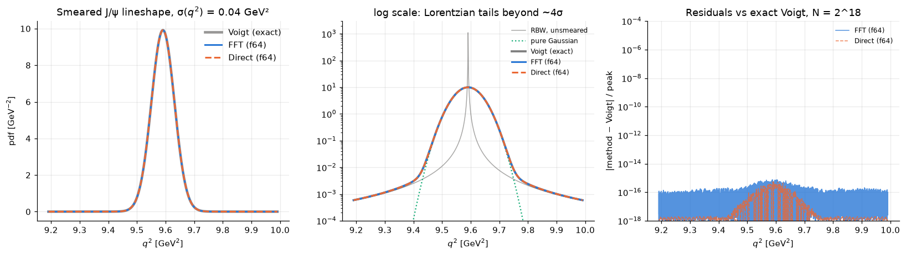
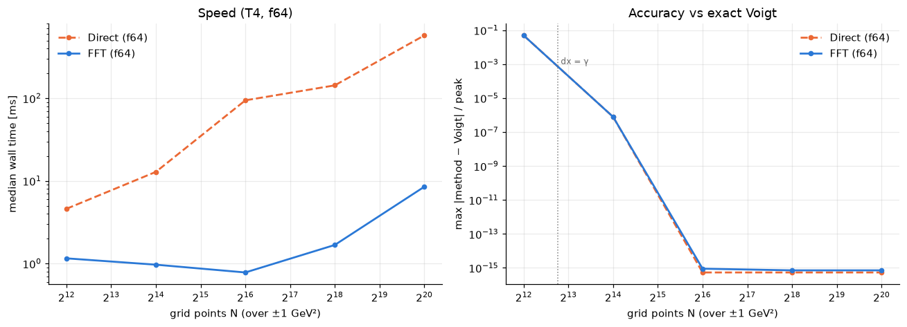
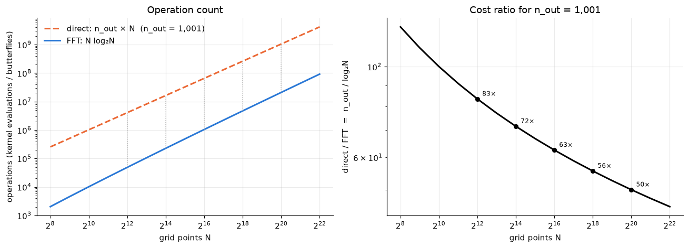

# conv_bench — smearing a J/ψ Breit–Wigner with a Gaussian: FFT vs direct integral on a GPU

Benchmark of two ways to convolve a relativistic Breit–Wigner (RBW) lineshape for the J/ψ in dimuon q²
with a Gaussian q² resolution of σ = 0.04 GeV², both implemented in TensorFlow and run on a Tesla T4:

1. **FFT convolution** – sample RBW and Gaussian on a uniform grid of N points, multiply spectra
   (`tf.signal.rfft`, zero-padded to 2N for a linear convolution), inverse transform.
2. **Direct numerical integral** – for each output point x_i evaluate Σ_j G(x_i − x_j) RBW(x_j) dx as a dense
   n_out × N matrix–vector product, built in ≤ 256 MiB chunks.

Both are checked against the exact answer: with a constant width the RBW in q² is a Lorentzian in
x = q² − M², and Lorentzian ⊗ Gaussian is a Voigt profile (`scipy.special.voigt_profile`).

Physics inputs: M = 3.0969 GeV, Γ = 92.6 keV, so the Lorentzian half-width in q² is γ = MΓ ≈ 2.9 × 10⁻⁴ GeV².
The resolution is ~140× wider than γ, so the grid has to resolve γ, which is what drives the required N.
Everything is computed in the centred variable x so that float32 stays usable (q² ≈ 9.6 GeV² would eat the mantissa).

## Repository layout

| File | Purpose |
|---|---|
| `make_notebook.py` | Generates `conv_bench.ipynb`. Edit this, not the notebook. |
| `conv_bench.ipynb` | The executed notebook (outputs included). |
| `setup.sh` | Builds the Python 3.12 venv (TensorFlow 2.21 + CUDA, scipy, pandas, matplotlib, jupyter). |
| `plots/`, `results/` | Figures, CSV timings and markdown summaries. Files suffixed `_f64` / `_f32` come from the current notebook; unsuffixed files are from an earlier 10-configuration version that also ran numpy and TF-CPU backends. |
| `CLAUDE.md` | Working notes: machine details, conventions, result tables, physics conclusions, next steps. |

## Running

```bash
bash setup.sh                                   # once
python3 make_notebook.py                        # regenerate the notebook from the generator
./venv/bin/jupyter nbconvert --to notebook --execute --inplace conv_bench.ipynb   # ≈ 1 min on a T4
```

The **Settings** cell at the top of the notebook controls everything:

```python
DTYPE  = "f64"                                 # "f64" or "f32" – precision for every GPU calculation
N_LIST = [2**k for k in (12, 14, 16, 18, 20)]  # grid sizes for the timing scan
N_PLOT = 2**18                                 # grid size for the lineshape figure
N_OUT_FIT = 30_000                             # output points assumed in the cost-model plot
```

Output files are suffixed with the dtype, so an f64 and an f32 run can coexist. The notebook picks the
least-loaded GPU with `nvidia-smi` before TensorFlow initialises and asserts that a GPU is present.

## Results (Tesla T4, TensorFlow 2.21, shared node so timings jitter by up to ~2–3×)

Median wall time in ms / max |method − Voigt| / peak over the ±0.4 GeV² window:

| method / dtype | N=2¹² | N=2¹⁴ | N=2¹⁶ | N=2¹⁸ | N=2²⁰ |
|:--|--:|--:|--:|--:|--:|
| FFT f64    | 1.2 / 0.049 | 1.0 / 7.8e-7 | 0.8 / 9e-16  | 1.7 / 7e-16 | 5.5 / 7e-16 |
| Direct f64 | 4.6 / 0.049 | 10 / 7.8e-7  | 34 / 5e-16   | 143 / 5e-16 | 575 / 5e-16 |
| FFT f32    | 0.8 / 0.049 | 0.8 / 1.2e-6 | 0.8 / 3.9e-7 | 0.8 / 5.8e-7 | 1.7 / 6.8e-7 |
| Direct f32 | 1.8 / 0.049 | 4.3 / 8.9e-7 | 13 / 1.9e-7  | 49 / 2.1e-7 | 210–580 / 2.8e-6 |

Bin-integrated versus point-sampled RBW (f64), max relative error:

| | N=2⁸ | N=2¹⁰ | N=2¹² | N=2¹⁴ | N=2¹⁶ |
|:--|--:|--:|--:|--:|--:|
| point-sampled (either method)  | 0.89   | 0.57    | 0.049  | 7.8e-7 | ~1e-15 |
| bin-integrated (either method) | 0.0043 | 0.00021 | 7.1e-6 | 3.9e-7 | 2.4e-8 |





### Conclusions

1. **The FFT wins by one to two orders of magnitude at every N.** At N = 2¹⁸ (dx ≈ 0.1γ, the first grid that
   reaches machine precision with a point-sampled RBW) it is ~3 ms vs ~150 ms in f64 and ~1 ms vs ~50 ms in f32.
   Up to N ≈ 2¹⁸ the FFT sits on the ~1 ms launch-overhead floor of eager TensorFlow.
2. **Both methods converge to the exact Voigt profile** (f64: ~10⁻¹⁵) once dx ≲ 0.1γ. N = 2¹⁴ gives 10⁻⁶,
   N = 2¹² (dx ≈ 1.7γ) is 5 % wrong. The bottleneck is the narrow J/ψ width, not the 0.04 GeV² resolution.
3. **Bin-integrated RBW** (analytic arctan average over each bin) makes coarse grids usable at zero extra cost:
   N = 2¹² reaches 10⁻⁵, N = 2¹⁴ reaches 4 × 10⁻⁷.
4. **float32 on the T4** (1/32-rate f64): the FFT in f32 is accurate to ~5 × 10⁻⁷ of peak and ~3× faster than
   f64 at large N; the direct method in f32 degrades with N through summation error.
5. Truncating the Lorentzian tails at ±1 GeV² loses ~10⁻⁴ of the norm but sits > 15σ from the output window,
   so it is invisible there.

## Notes from the design discussion

**Evaluation points differ between the methods, and nothing is interpolated.** The FFT delivers the
convolution on the N-point sampling grid, so its accuracy is measured on the grid points that fall inside
±0.4 GeV² (about 105 000 of them at N = 2¹⁸). The direct method takes its output points as an explicit
argument, so it is evaluated on a fixed 1001-point `X_OUT` that is not aligned with the grid. Each method is
compared against the Voigt profile at its own points; they are never compared to each other point by point.
Two consequences: the timings are for different output counts (the direct cost is ∝ n_out × N with
n_out = 1001), and in a real fit the FFT result would still have to be interpolated onto the event q² values,
which the benchmark currently does not time. The planned follow-up is to interpolate the FFT output onto
`X_OUT` inside the timed call so both methods report on identical points; on a dx ≈ 10⁻⁵ grid the linear
interpolation error is ~10⁻¹¹ of peak, so it will not spoil the f64 comparison above N ≈ 2¹⁶.

**How the direct integral is coded.** `x_out[:, None] - x[None, :]` turns a length-n_out column and a
length-N row into an n_out × N matrix of differences x_i − x_j by broadcasting (each axis of length 1 is
stretched to match the other operand). Dividing by σ gives the distance in units of σ; `tf.exp(-0.5*d*d)`
squares it and evaluates the unnormalised Gaussian on the whole matrix; `tf.linalg.matvec` multiplies by the
RBW vector; the factor dx/(σ√2π) is applied once at the end. The wrapper splits the output points into row
chunks so that no kernel block exceeds 256 MiB (the full matrix at N = 2²⁰ in f64 would be 8 GB), and
`tf.function(reduce_retracing=True)` compiles each chunk call into a single GPU graph.

**Cost model.** For n_out output points the direct method costs n_out × N kernel evaluations and the FFT
N log₂N, so the ratio is n_out / log₂N. For n_out = 30 000 (events in a fit) that is ~2500× at N = 2¹² and
~1500× at N = 2²⁰; the lines never cross for any realistic N. These are operation counts, not times: the FFT's
constant per operation is larger (zero-padding to 2N, three transforms), so the measured gap at n_out = 1001
is ~30–100× rather than the raw 1001 / log₂N.

## Possible next steps

- Interpolate the FFT output onto `X_OUT` so both methods are timed and compared on the same points.
- Mass-dependent width / Blatt–Weisskopf RBW (no analytic Voigt reference; FFT vs direct only).
- ψ(2S) or the full B → K*μμ q² spectrum with interference; q²-dependent σ.
- Benchmark inside a `tf.function` fit loop with gradients through `tf.signal.rfft`.
